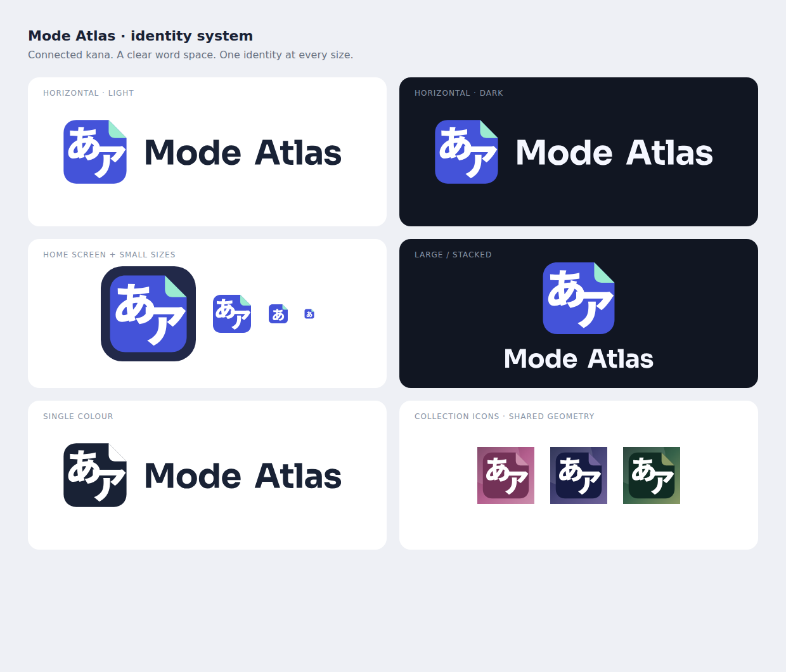

# Mode Atlas identity

The Japanese identity is the connected hiragana **あ** and katakana **ア** pair. The folded-page silhouette links it to an atlas and a place to build knowledge. Flat indigo and mint, precise geometry and an outlined wordmark carry the technology side of the identity. The name always has a visible word space: **Mode Atlas**.

## Assets and use

| Use | Asset |
| --- | --- |
| Standard symbol, navigation and launch mark | `assets/brand/mode-atlas-symbol.svg` |
| Wordmark, tinted by the UI surface | `assets/brand/mode-atlas-wordmark.svg` |
| Horizontal mark on a light surface | `assets/brand/mode-atlas-lockup-light.svg` |
| Horizontal mark on a dark surface | `assets/brand/mode-atlas-lockup-dark.svg` |
| Large stacked mark, light/dark surface | `assets/brand/mode-atlas-stacked-light.svg`, `mode-atlas-stacked-dark.svg` |
| Single-colour export with transparent cut-outs | `assets/brand/mode-atlas-lockup-mono.svg` |
| Small browser tab mark | `assets/brand/mode-atlas-micro.svg`, `assets/favicon-32.png` |
| Opaque app icon | `assets/mode-atlas-icon.svg`, `assets/android-chrome-512.png`, `assets/apple-touch-icon.png` |
| iOS 1024-pixel default icon | `ios/App/App/Assets.xcassets/AppIcon.appiconset/AppIcon-512@2x.png` |

The normal symbol uses the paired kana. Below 24 pixels use the simplified micro mark, which keeps the hiragana and folded corner without squeezing two characters into a browser tab. Keep the artwork in proportion and leave at least one eighth of the symbol width clear around stand-alone uses. The app icon already includes its inset; iOS supplies its outer corner mask.

The horizontal exports suit banners and wide headers; the stacked versions suit larger central placements. Both are resolution-independent. Do not merge the words, stretch the mark, add a glow, or substitute live Japanese text for the outlines. UI wordmarks use the current surface’s semantic text colour so owned themes retain readable contrast.

## Sources and regeneration

`assets/brand/mode-atlas-mark.svg` owns the Japanese outlines. `assets/brand/mode-atlas-wordmark.svg` owns the optically spaced outlined Sora 720 lettering. Existing font licences are in `assets/fonts/noto-sans-jp-LICENSE.txt` and `assets/fonts/sora-LICENSE.txt`. These marks contain no font-loading dependency.

`node build_brand_assets.cjs` derives the standard, micro, horizontal, stacked and single-colour SVGs plus default platform PNGs and the native template wordmark. `node build_ios_reward_icons.cjs` uses the same symbol geometry with the existing collection palettes. Playwright’s installed Chromium is required; an existing system executable can be selected with `PLAYWRIGHT_CHROMIUM_EXECUTABLE_PATH`.

The website shared navigation, native dock, loading screen, About and Rewards all reference these outputs. iOS launch text uses a template image tinted with `labelColor`. Collection purchases, grants and icon switching still belong to their original catalogue and native bridge.

From 2.115.0, `frontend_components.apply_brand_metadata` publishes content-fingerprinted copies for all page favicon/touch links and the install manifest. The app ID stays stable; only changed artwork changes an icon URL. Run the normal revision build after regenerating brand artwork.
