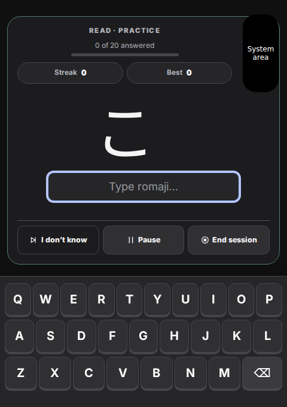
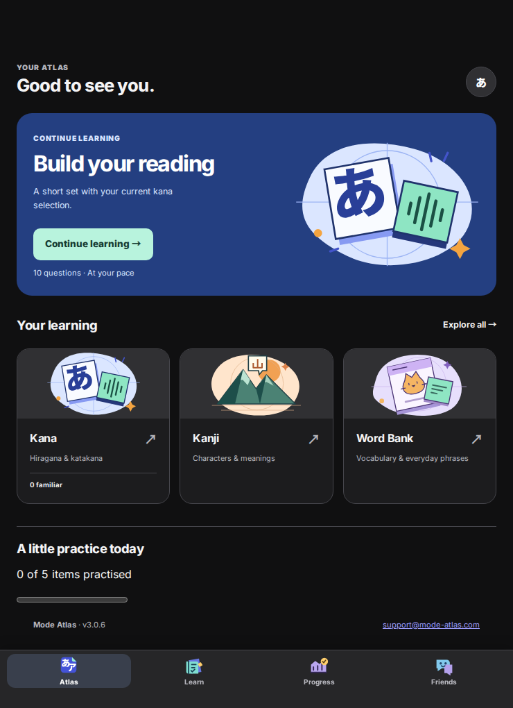

# Duo workspace review — 3.0.6

The user's four 23 October screenshots were inspected directly. This review
covers the remaining space/layout issues, not the separate full-product PDF audit.

## Findings and source corrections

| Reported surface | Cause | Correction |
| --- | --- | --- |
| Profile popup | The system's right safe inset narrowed the entire sheet, including the clear area below the status display. | The account header/tabs retain protection; the scrolling body begins below system UI and can use the clear width. Bottom-dock clearance is retained. |
| Running Kana trainer and keyboard | A whole-height safe inset and hidden-rail reservation remained. | The chrome owner releases unused navigation width, expands the active card, and protects only the rows that overlap a system region or Exit focus. The keyboard uses the clear bottom width. |
| Resume setup | A full-width checkpoint was placed in one track of a two-column grid. | It spans both tracks; Resume/Discard share one row. |
| Tall Home | A shared first-use breakpoint hid artwork while the native grid retained two columns. | Restore the existing illustration where two columns fit; adjust branch-card capacity by content width. |
| Other activities | Narrow dialog/lesson limits and stacked handwriting tools left usable width unused. | Wider native word lessons pair word/audio with context. Wide Kanji teaching pairs character/reading/context. Handwriting arranges board and tools together. Shared popup placement uses the clear rectangle. |
| Older popups | First-use consent, tours and the developer console retained independent viewport rules. | Reuse the clear native rectangle; tour cards respond to native-only system-region changes while the spotlight stays attached to its target. |

The existing native chrome is the layout owner; no second router, CSS override
file, device-name detection, icon replacement, theme rewrite or grading/save
change was introduced. Generated assets come from the existing build pipeline.

## Geometry contract and research

The bridge reports `reservedRegionsAvailable` only after reading UIKit reserved
regions. Its existing native width/height, independent safe-area insets and
occlusions remain authoritative. Stale snapshots and older shells fall back to
the safe rectangle. The upper gutter remains protected to include hardware that
may not have a separate reserved-region entry. Expanded fixed controls require
clearance below the system area. Shared dialogs keep the safe rectangle when
keyboard/window height cannot support the wider region.

Apple guidance reviewed:

- [Prepare your app for iPhone Duo](https://developer.apple.com/videos/play/tech-talks/111461/): local window geometry, asymmetric insets and reserved regions for custom UI.
- [Strike a pose with adaptive layouts on iPhone Duo](https://developer.apple.com/videos/play/tech-talks/111463/): move related elements together and keep contextual controls unobstructed.

## Validation and limits

- Release gate: **297 JavaScript tests and 23 Python tests passed**, plus source,
  security, learning-content and native-bundle audits.
- **148 distinct browser cases passed across two regression runs:** 125 in the
  broad layout run, then 49 covering the final popup changes and existing
  first-use, tour and developer flows (26 overlap). Earlier
  checks exposed bottom-dock overlap and a delayed fallback-inset update; both
  were fixed in the layout owner without weakening their assertions.
- **12 mobile iOS-shell checks passed**.
- The release bump exposed a hard-coded 3.0.5 string in the Xcode recovery test
  fixture. The fixture now derives the release version and continues to create
  real conflicts. The subsequent staged-project screenshot exposed an index-only
  failure before conflict creation. The recovery helper now handles that path;
  all 17 recovery tests pass, including the documented resume command through
  its Xcode launch invocation.
- Handover/recovery shell syntax and `git diff --check` passed.
- Native Swift compilation/archive is covered by the PR's GitHub macOS job.

Coverage includes all existing route layouts, Light/Dark, first-use/established
Home, old-shell/stale-geometry fallbacks, left/right system strips, changing
occlusions, keyboard bounds, mixed/practice/test modes, checkpoint resume,
folding during an answer, profile/settings focus, handwriting stroke retention,
and larger text. First-use consent reaches the first lesson, and tour navigation
and dismissal remain functional with system UI on either side. A native-event-only handwriting test reproduces both movement
and resizing without a window resize: completed strokes remain, while the
unfinished stroke is cancelled. The screenshots below use simulated native geometry, not
physical-device results. Labelled black system regions are test annotations.
Network requests are isolated, so account screens show the offline fallback;
this is not a production authentication test. Actual Device Hub/device camera,
Live Activity and fold behavior still need acceptance on the user's Mac.

## Rendered evidence

| Surface | Evidence |
| --- | --- |
| Reading, outer and wide | [Outer](screenshots/reading-outer.png), [wide](screenshots/reading-wide.png), [tall](screenshots/reading-portrait.png) |
| Recall and checkpoint | [Recall](screenshots/recall-outer.png), [Resume](screenshots/resume.png) |
| Account and Home | [Profile](screenshots/profile-outer.png), [Home](screenshots/home-portrait.png) |
| Branch activities | [Words](screenshots/word-wide.png), [Kanji](screenshots/kanji-wide.png), [handwriting](screenshots/handwriting-outer.png) |
| First use and guided help | [Welcome](screenshots/welcome-outer.png), [tour with moved system region](screenshots/tour-left.png) |

