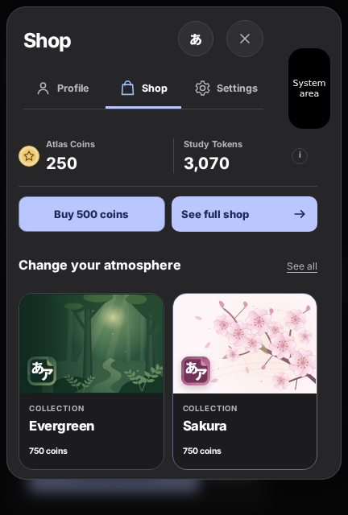
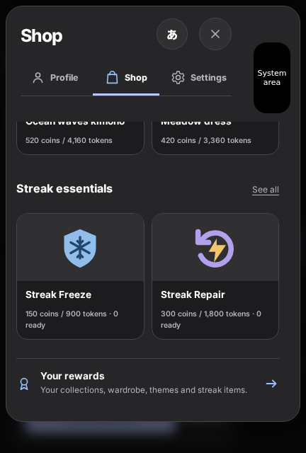
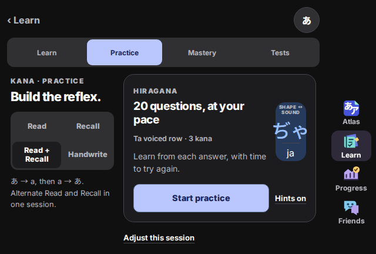

# Shop and closed-Duo landscape review — 3.0.7

24 October 2026 · iOS build 2080053

## Assessment

The supplied device images show a real loss of usable height. In the account
Shop, `.ma-shop-preview > .ma-shop-header` was sticky. It included two balances,
a separate coin-purchase row and a separate full-shop button. Scrolling products
could never reclaim that area. In closed landscape, the dock required 600 pixels
of content width after safe insets and the rail. A phone-width landscape window
therefore kept a bottom dock while also reserving the system-side strip. Kana's
viewport-width breakpoint then made the branch tabs larger at the same time.

A side dock is the better use of this short landscape window. It returns vertical
space to the task and uses the spare side strip when native geometry confirms
that the controls fit there. The alternative of extending every page behind the
system region while retaining a bottom dock would leave the vertical bottleneck.

## Implementation and boundaries

| Surface | Change | Boundary |
| --- | --- | --- |
| Account Shop | Scroll wallet, actions and products together; compact balances; pair the existing two actions when they fit | Account title, tabs and Close remain available; token help keeps a 44-pixel target; large text stacks actions |
| Native dock | Allow a phone-width content area beside a rail; prefer the clear system-side strip | Read current native bounds, independent safe insets and occlusions; a confirmed empty reserved-region snapshot can host the rail too |
| Short rail | Keep artwork and labels, tighten vertical spacing; 52-pixel minimum targets | Normal rail remains at least 64 pixels; the compact rail is selected only when the normal rail cannot fit |
| System panel expands | Re-evaluate on the native region event | Move inside the safe area if needed; use bottom navigation if neither rail fits |
| Kana navigation | Keep the native segmented tabs through rotation | Desktop web retains its existing navigation treatment |
| Kana Practice | Place the skill controls beside the session in a short, sufficiently wide content container | Reflow to one column when width or text size requires it; preserve skill, hints and session behavior |

In the 432 × 640 screenshot-proportion browser case, the same guest-wallet header
measured about **215 pixels before and 109 after**. Once scrolled, it consumes no
pinned product area. In the 640 × 432 landscape case, Start practice fits above
the bottom safe inset with the rail visible. These are test window dimensions,
not a claim about Apple's hardware specifications.

The layout choice follows Apple's guidance to use local window capacity and
independent safe areas, and to use reserved regions for custom bars. Apple
describes compact vertical and horizontal size classes on the closed landscape
display and warns against making layout decisions from device identity or
interface orientation alone. Source: [Prepare your app for iPhone Duo](https://developer.apple.com/videos/play/tech-talks/111461/), chapters “Use size classes,” “Respect safe areas” and “Use reserved regions.”

## Validation

- `npm run release:check`: 297 JavaScript tests, 23 Python tests, project/security/
  learning audits, generated assets and native web-bundle checks passed.
- Desktop Chromium: **184 cases passed**, including 13 new compact-Duo cases.
- Mobile Chromium: **12 iOS-shell cases passed**.
- Native build results are reported through GitHub CI, separately from browser geometry checks.
- New regressions cover shop scrolling and navigation, both appearances, both
  system-side positions, compact-rail touch targets, growing/empty system regions,
  large-text fallback and rotation without resetting skill or hints.
- Existing regressions cover first use, curriculum, sessions, account handling,
  themes, popups and handwriting across narrow, wide, short and tall windows.

Saved render evidence uses a black “System area” annotation to represent the
simulated reserved region. Chromium does not draw UIKit's status panel. The
provided screenshots were reviewed, but the updated code has not been run on
Jack's physical device here. Native compilation and simulator/archive results
must be reported separately from these browser tests.

No backend deployment, save-schema change or Xcode preference reset is involved.
The existing in-place Mac update workflow is included in the
[handover](../../development-3.0.7.md).

## Rendered evidence

See [evidence.json](evidence.json) for the measured run and screenshot mapping.

